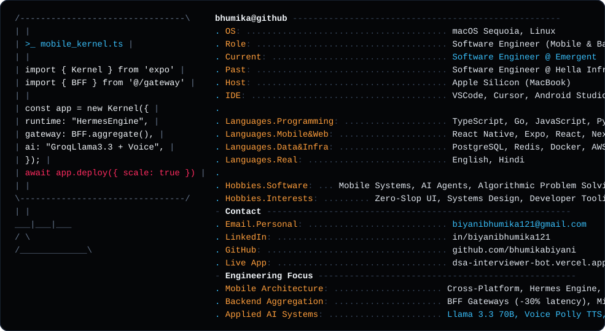

<div align="center">

  

  <br/><br/>

  <a href="https://bhumika-biyani.vercel.app/">
    
  </a>

  <p align="center">
    <strong>Building high-speed mobile apps, resilient distributed systems, and smart AI agents</strong>
  </p>

  <p align="center">
    <a href="https://bhumika-biyani.vercel.app/" target="_blank"></a>
    <a href="https://linkedin.com/in/biyanibhumika121" target="_blank"></a>
    <a href="https://github.com/bhumikabiyani?tab=repositories"></a>
    <a href="mailto:biyanibhumika121@gmail.com"></a>
  </p>

</div>

---

### ⚡ Snapshot & Systems Focus

```yaml
Current Role: Engineer @ Emergent
Past Experience: Software Engineer @ Hella Infra Market
Core Disciplines: Production Mobile (React Native / Expo), Backend Architecture (Go / Node.js), Applied AI
Location: Bengaluru, India
Current Focus: Debugging AI-generated architectures, native iOS/Android bridge internals, deterministic LLM pipelines
```
---

### 🕹️ Interactive Portfolio Arcade & AI Dock

> 🎮 **Realtime In-Browser Arcade**: I engineered a retro Snake Game with global persistent leaderboards (backed by serverless Upstash Redis) and an interactive AI Assistant right inside my personal developer portfolio.
>
> 👉 [**Play Snake & Challenge My High Score on My Live Portfolio ↗**](https://bhumika-biyani.vercel.app/)

---

### 🛠️ Core Tech Stack & Tooling

<p align="center">
  
</p>

<div align="center">

| Domain | Technologies & Frameworks |
| :--- | :--- |
| **Mobile & Frontend** | `React Native` · `Expo` · `TypeScript` · `React` · `Next.js` · `Android (16KB)` · `iOS Native` · `Hermes` |
| **Backend & Systems** | `Go (Golang)` · `Node.js` · `Express.js` · `FastAPI` · `BFF Architecture` · `RESTful Microservices` |
| **Databases & Cloud** | `PostgreSQL` · `Redis` · `AWS (Polly, S3)` · `Docker` · `Git` · `CI/CD Workflows` |
| **Applied AI & ML** | `LLM Integrations` · `Groq Llama 3.3 70B` · `AWS Polly Neural TTS` · `AI App Debugging & Fixes` |

</div>

---

### 📊 GitHub Activity & Metrics

<div align="center">
  <!-- <a href="https://bhumika-biyani.vercel.app/">
    
  </a> -->

  <!-- <br/><br/> -->

  <p align="center">
    <a href="https://github.com/bhumikabiyani">
      
    </a>
    <!-- <a href="https://github.com/bhumikabiyani">
      
    </a> -->
  </p>
</div>

---

### 🐍 Contribution Activity

<div align="center">
  
</div>

---


<p align="center">
  <a href="https://linkedin.com/in/biyanibhumika121" target="_blank">
    
  </a>
  &nbsp;&nbsp;
  <a href="mailto:biyanibhumika121@gmail.com">
    
  </a>
</p>
