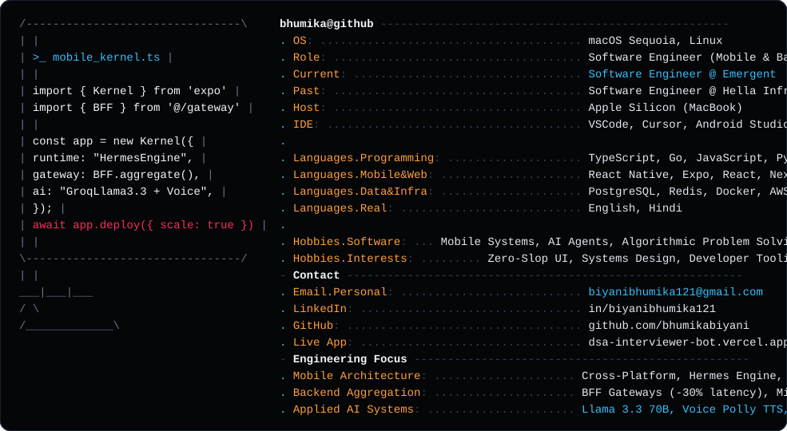

<div align="center">

  

  <br/><br/>

  <a href="https://bhumika-biyani.vercel.app/">
    
  </a>

  <p align="center">
    <strong>Building reliable systems — from high-performance mobile apps to distributed backends & AI agents.</strong>
  </p>

  <p align="center">
    <a href="https://bhumika-biyani.vercel.app/" target="_blank"></a>
    <a href="https://linkedin.com/in/biyanibhumika121" target="_blank"></a>
    <a href="https://dsa-interviewer-bot.vercel.app/" target="_blank"></a>
    <a href="mailto:biyanibhumika121@gmail.com"></a>
    <a href="https://github.com/bhumikabiyani?tab=repositories"></a>
  </p>

</div>

---

### ⚡ Snapshot & Systems Focus

```yaml
Current Role: Technical Solutions Engineer - Expo @ Emergent
Past Experience: Software Engineer @ Hella Infra Market
Core Disciplines: Production Mobile (React Native / Expo), Backend Architecture (Go / Node.js), Applied AI
Location: Bengaluru, India
Current Focus: Debugging AI-generated architectures, native iOS/Android bridge internals, deterministic LLM pipelines
Systems Philosophy: High runtime reliability, sub-second latency, zero UI slop
```

---

### 🏗️ 3-Tier Systems Architecture Blueprint

```text
 ┌────────────────────────────────────────────────────────────────────────┐
 │                        CLIENT & EDGE LAYER                             │
 │   React Native · Expo · Hermes Engine · 16KB Page Android · iOS Bridge │
 └──────────────────────────────────┬─────────────────────────────────────┘
                                    │ (Sub-second RPC / Event Streams)
 ┌──────────────────────────────────▼─────────────────────────────────────┐
 │                    ORCHESTRATION & BFF GATEWAY                         │
 │     Go REST APIs · Node.js/Express BFF Aggregator (-30% Latency)       │
 └──────────────────────────────────┬─────────────────────────────────────┘
                                    │ (ACID Isolation & Neural Pipelines)
 ┌──────────────────────────────────▼─────────────────────────────────────┐
 │                     DATA & INTELLIGENCE FOUNDATION                     │
 │   PostgreSQL · Redis Cache · Groq Llama 3.3 70B · AWS Polly Voice TTS  │
 └────────────────────────────────────────────────────────────────────────┘
```

---

### ⚡ Production Impact & Engineering Metrics

| Metric | System Component | Technical Highlight |
| :---: | :---: | :--- |
| **⚡ -30%** | **BFF Gateway Layer** | Reduced client-side cascade latency across 8+ aggregated microservices |
| **🚀 -60%** | **Dynamic Form Engine** | Schema-driven JSON platform slashing new enterprise form delivery cycles |
| **🔒 ACID** | **Transactional Seat Engine** | Zero double-bookings under concurrent load with Go + PostgreSQL row locks |
| **🎙️ <1s** | **Neural Voice Pipeline** | Real-time speech evaluation feedback loop with AWS Polly & Groq Llama 3.3 |

---

### 🚀 Featured & Flagship Systems

<table>
  <tr>
    <td width="50%" valign="top">
      <h3 align="center">🧠 AlgoMentor</h3>
      <p align="center"><strong>AI-Powered Real-Time DSA Mock Interview Platform</strong></p>
      <ul>
        <li>Interactive simulator evaluating candidate problem-solving, algorithmic correctness, and verbal communication in real time.</li>
        <li>Orchestrates <strong>Groq Llama 3.3 70B</strong> for dynamic multi-turn technical questioning and automated candidate scoring.</li>
        <li>Integrated sub-second voice synthesis via <strong>AWS Polly Neural TTS</strong> with PostgreSQL persistent interview sessions.</li>
      </ul>
      <p align="center">
        <code>Next.js</code> · <code>FastAPI</code> · <code>PostgreSQL</code> · <code>AWS Polly</code> · <code>Groq LLM</code>
      </p>
    </td>
    <td width="50%" valign="top">
      <h3 align="center">🎟️ Movie Booking System</h3>
      <p align="center"><strong>Concurrency-Safe Ticketing & Seat Reservation Platform</strong></p>
      <ul>
        <li>Engineered a cross-platform mobile booking client with interactive seat map selection and real-time show status updates.</li>
        <li>Backed by a high-throughput <strong>Golang REST API</strong> handling transactional seat reservation operations.</li>
        <li>Strict relational data modeling with <strong>PostgreSQL</strong> enforcing ACID consistency under concurrent seat booking requests.</li>
      </ul>
      <p align="center">
        <code>React Native</code> · <code>TypeScript</code> · <code>Golang</code> · <code>PostgreSQL</code> · <code>REST APIs</code>
      </p>
    </td>
  </tr>
  <tr>
    <td width="50%" valign="top">
      <h3 align="center">⚡ BFF Microservices Aggregator</h3>
      <p align="center"><strong>High-Throughput Backend-for-Frontend Gateway</strong></p>
      <ul>
        <li>Architected a dedicated BFF service aggregating <strong>8+ microservice APIs</strong> into optimized client-facing endpoints.</li>
        <li>Eliminated frontend data-fetching cascades and reduced client API response times by <strong>~30%</strong>.</li>
        <li>Centralized cross-service data shaping, token authentication, and redundant network request deduplication.</li>
      </ul>
      <p align="center">
        <code>Node.js</code> · <code>Express.js</code> · <code>Golang</code> · <code>REST APIs</code> · <code>Microservices</code>
      </p>
    </td>
    <td width="50%" valign="top">
      <h3 align="center">🧩 Dynamic Form Framework</h3>
      <p align="center"><strong>Schema-Driven Dynamic UI Generation Platform</strong></p>
      <ul>
        <li>Engineered a production JSON-driven dynamic form engine in <strong>React & TypeScript</strong> for enterprise workflows.</li>
        <li>Supports complex conditional field rendering, nested dependencies, dynamic schema validation, and state persistence.</li>
        <li>Reduced new form engineering cycles by <strong>~60%</strong> across 10+ business-critical product workflows.</li>
      </ul>
      <p align="center">
        <code>React</code> · <code>TypeScript</code> · <code>Redux</code> · <code>JSON Schema</code> · <code>Tailwind CSS</code>
      </p>
    </td>
  </tr>
</table>

---

### 🕹️ Interactive Portfolio Arcade & AI Dock

> 🎮 **Realtime In-Browser Arcade**: I engineered a retro Snake Game with global persistent leaderboards (backed by serverless Upstash Redis) and an interactive AI Assistant right inside my personal developer portfolio.
>
> 👉 [**Play Snake & Challenge My High Score on My Live Portfolio ↗**](https://bhumika-biyani.vercel.app/)

---

### 🛠️ Core Tech Stack & Tooling

<p align="center">
  
</p>

<div align="center">

| Domain | Technologies & Frameworks |
| :--- | :--- |
| **Mobile & Frontend** | `React Native` · `Expo` · `TypeScript` · `React` · `Next.js` · `Android (16KB)` · `iOS Native` · `Hermes` |
| **Backend & Systems** | `Go (Golang)` · `Node.js` · `Express.js` · `FastAPI` · `BFF Architecture` · `RESTful Microservices` |
| **Databases & Cloud** | `PostgreSQL` · `Redis` · `AWS (Polly, S3)` · `Docker` · `Git` · `CI/CD Workflows` |
| **Applied AI & ML** | `LLM Integrations` · `Groq Llama 3.3 70B` · `AWS Polly Neural TTS` · `AI App Debugging & Fixes` |

</div>

---

### 📊 GitHub Activity & Metrics

<div align="center">
  <a href="https://bhumika-biyani.vercel.app/">
    
  </a>

  <br/><br/>

  <p align="center">
    <a href="https://github.com/bhumikabiyani">
      
    </a>
    <a href="https://github.com/bhumikabiyani">
      
    </a>
  </p>
</div>

---

### 🐍 Contribution Activity

<div align="center">
  
</div>

---

### 💬 Let's Connect & Build

```bash
┌──(bhumika㉿github)-[~]
└─$ ping -c 1 bhumika.engineer
64 bytes from bhumikabiyani: icmp_seq=1 ttl=64 time=0.042 ms

--- Open to high-impact mobile, backend, and applied AI engineering challenges ---
```

<p align="center">
  <a href="https://linkedin.com/in/biyanibhumika121">
    
  </a>
  &nbsp;&nbsp;
  <a href="mailto:biyanibhumika121@gmail.com">
    
  </a>
</p>
